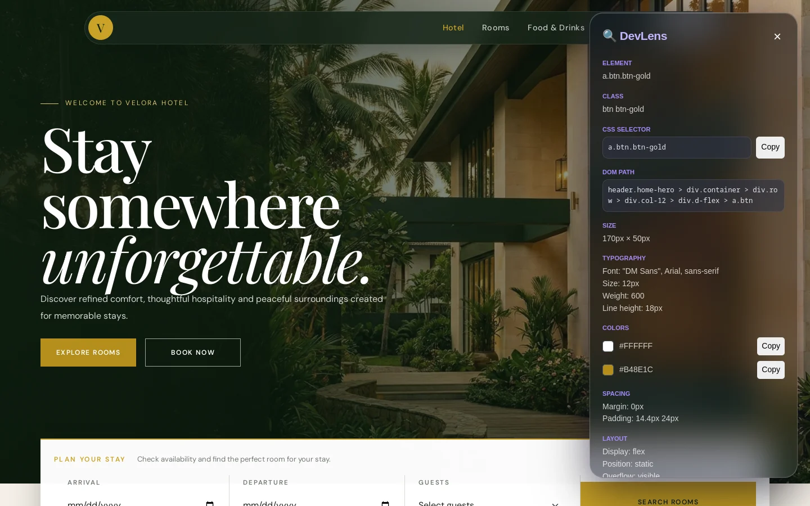
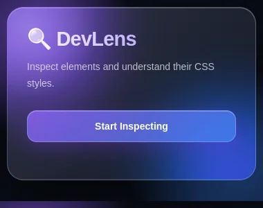

# DevLens

A Chrome extension for inspecting any element on a web page and understanding its CSS. Click **Start Inspecting**, hover the page, click an element, and DevLens opens a panel with its styles and a plain-English explanation of its layout.



## Features

- **Hover to highlight:** outlines elements as you move the mouse
- **Style panel:** selector, DOM path, size, spacing, typography, colours and layout of the clicked element
- **Explain:** turns computed styles into plain English (Flexbox, Grid, positioning, spacing)
- **Copy buttons:** copy the selector, text colour, background or the element's CSS
- **Framework hints:** detects common frameworks on the page
- **Esc** stops inspecting

## Screenshots

| Popup | Inspector panel |
| --- | --- |
|  |  |

## Tech stack

| Part | Technology |
| --- | --- |
| Popup | React, Vite |
| Inspector | Plain JavaScript content scripts (`public/inspector.js`, `public/explainer.js`) |
| Extension | Chrome Manifest V3 (`activeTab`, `scripting`) |

## Run it locally

```bash
npm install
npm run build
```

Then load it in Chrome:

1. Open `chrome://extensions` and turn on **Developer mode**.
2. Click **Load unpacked** and pick the `dist` folder.
3. Pin DevLens, open any website and click **Start Inspecting**.

`npm run dev` serves the popup alone for styling work; the inspector only runs inside the extension.
